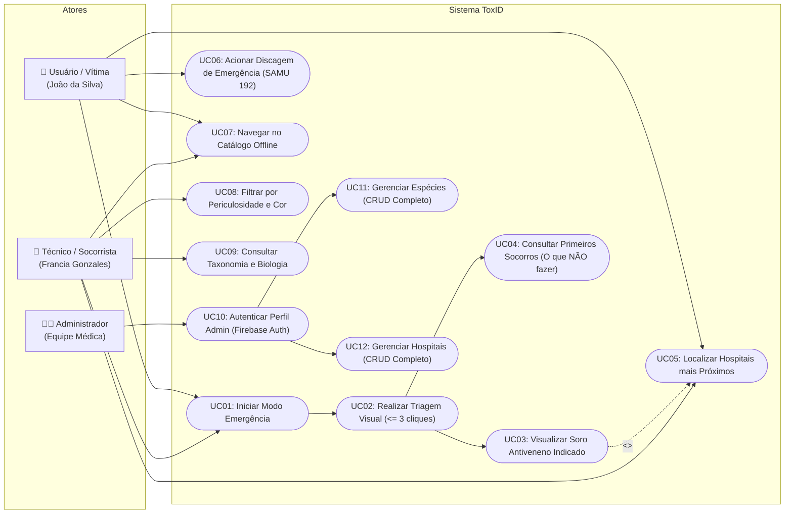

# Diagrama e Especificação de Casos de Uso — ToxID

**Instituição:** Universidade Tiradentes (Unit)  
**Disciplina:** Programação para Dispositivos Móveis  
**Docente:** Layse Santos Souza  
**Equipe:** Davi Bomfim de Oliveira, Erick Thalles Dantas Freire, Luís Felipe Carmelo da Silva, Paula Ximena Antonio Franco, Sara Jimena Barrera Mora  

---

## 1. Visão Geral dos Atores

1. **Vítima / Trabalhador Rural (Persona Primária: João da Silva):**
   - Usuário sob extremo estresse e sem conexão com a internet.
   - Necessita de identificação imediata do animal em no máximo 3 cliques e instruções vitais de primeiros socorros.
2. **Profissional de Campo / Bombeiro / Zoonoses (Persona: Francia Gonzales):**
   - Usuário técnico que necessita de dados taxonômicos confiáveis, identificação precisa do soro específico e localização dos centros antiveneno.
3. **Administrador do Sistema (Perfil Administrativo):**
   - Profissional habilitado responsável pela curadoria, adição, edição e exclusão de espécies biológicas e hospitais de referência no banco Firestore.

---

## 2. Diagrama de Casos de Uso (UML / Mermaid)

---

## 3. Especificação Textual dos Principais Casos de Uso

### UC01 & UC02: Modo Emergência e Triagem Visual
* **Ator Principal:** Usuário Vítima / Agricultor.
* **Pré-condições:** Nenhuma (o app é offline-first).
* **Fluxo Principal:**
  1. O usuário clica no botão vermelho gigante na Home ("Não sei o que me picou").
  2. O sistema exibe o Passo 1: 4 botões visuais (Répteis, Aracnídeos, Anfíbios, Insetos).
  3. O usuário toca na categoria reconhecida (ex.: Répteis).
  4. O sistema exibe o Passo 2 com características físicas marcantes (ex.: "Possui chocalho na cauda", "Anéis coloridos", "Manchas em V").
  5. O usuário toca na característica observada.
  6. O sistema exibe instantaneamente o Passo 3 com o diagnóstico preliminar, a foto da espécie, o Soro Indicado em destaque e o que NÃO fazer.
* **Pós-condições:** Diagnóstico exibido em 3 cliques ou menos (RNF01 satisfeito).

### UC05: Localizar Hospitais de Referência
* **Ator Principal:** Vítima / Socorrista.
* **Fluxo Principal:**
  1. O usuário acessa a aba de Hospitais ou clica no botão "Localizar Hospital" na ficha do animal.
  2. O sistema obtém as coordenadas GPS do aparelho temporariamente (respeitando a LGPD - RNF06).
  3. O sistema calcula a distância geodésica (fórmula de Haversine) e o tempo estimado de trajeto até cada centro antiveneno.
  4. A lista é exibida ordenada do hospital mais próximo para o mais distante.
  5. O usuário pode tocar em "Ligar" para discar imediatamente para a unidade.

### UC10, UC11 e UC12: Gestão Administrativa (CRUD)
* **Ator Principal:** Administrador.
* **Regra de Negócio Crítica:** O usuário final possui estritamente acesso de Leitura (R - Read) para evitar adulteração de dados vitais de antivenenos. Somente administradores autenticados via Firebase Auth possuem permissão de Criação, Edição e Exclusão (C, U, D) nas coleções `especies` e `hospitais`.

## Ocorrências pessoais

A triagem oferece uma saída inconclusiva. Uma identificação com resultado armazena a ocorrência localmente, com coordenadas opcionais. O visitante acessa o histórico do dispositivo; o usuário autenticado possui histórico separado por UID e sincronização. O resultado permite compartilhar um alerta ou um arquivo PDF.
