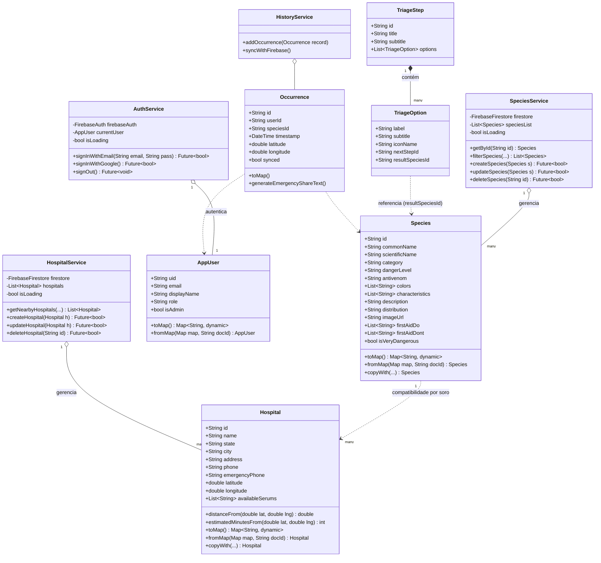

# Diagrama de Classes (Modelos de Domínio) — ToxID

**Instituição:** Universidade Tiradentes (Unit)  
**Disciplina:** Programação para Dispositivos Móveis  
**Docente:** Layse Santos Souza  

---

## 1. Visão Geral da Arquitetura de Domínio

O domínio do ToxID é estruturado em entidades ricas que encapsulam dados, serialização com o Cloud Firestore e métodos de cálculo de negócios (ex.: fórmula geodésica de Haversine para distâncias hospitalares e classificação de risco).

---

## 2. Diagrama de Classes UML (Mermaid)

---

## 3. Métodos e Responsabilidades Principais

### `Species`
* **`toMap()`**: Serializa a instância Dart em documento JSON compativel com o Cloud Firestore.
* **`fromMap(map, docId)`**: Desserializa documentos recebidos do Firestore ou dos assets JSON locais.
* **`isVeryDangerous`**: Propriedade computada para acionar alertas de nível crítico na interface.

### `Hospital`
* **`distanceFrom(userLat, userLng)`**: Implementa a fórmula esférica de Haversine:
  $$d = 2R \cdot \arcsin\left(\sqrt{\sin^2\left(\frac{\Delta\phi}{2}\right) + \cos(\phi_1)\cos(\phi_2)\sin^2\left(\frac{\Delta\lambda}{2}\right)}\right)$$
  Calcula a distância em linha reta precisa em quilômetros sem requisições a APIs pagas.
* **`estimatedMinutesFrom(userLat, userLng)`**: Estima o tempo médio em minutos para deslocamento rodoviário (velocidade média de 50 km/h).
