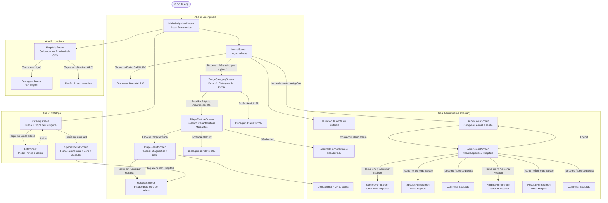

# Fluxo de Navegação Real do Aplicativo — ToxID

**Instituição:** Universidade Tiradentes (Unit)  
**Disciplina:** Programação para Dispositivos Móveis  
**Docente:** Layse Santos Souza  

---

## 1. Visão Geral da Navegação

A navegação do ToxID foi desenhada para eliminar atritos em situações críticas de pânico e emergência:
- Uma barra inferior persistente (`BottomNavigationBar`) dá acesso direto às 3 áreas fundamentais do app: **Emergência**, **Catálogo** e **Hospitais**.
- O fluxo de emergência é uma pilha sequencial com no máximo 3 telas até o diagnóstico e indicação do soro (atendendo ao RNF01).
- Um atalho discreto na AppBar permite o acesso dos gestores ao **Painel Administrativo** mediante autenticação Firebase Auth.

---

## 2. Mapa do Fluxo de Telas (Mermaid)

---

## 3. Detalhamento dos Gatilhos e Transições

1. **`HomeScreen` -> `TriageCategoryScreen`**:
   - Acionado pelo botão gigante vermelho com alerta.
   - Utiliza transição padrão `MaterialPageRoute`.
2. **`TriageCategoryScreen` -> `TriageFeatureScreen`**:
   - Passa como argumento a chave da categoria selecionada (`Reptiles`, `Arácnidos`, `Anfibios`, `Insectos`).
3. **`TriageFeatureScreen` -> `TriageResultScreen`**:
   - Passa o `speciesId` da correspondência da árvore de decisão.
4. **`TriageResultScreen` -> `HospitalsScreen`**:
   - Passa como parâmetro opcional o nome do soro indicado (`requiredSerum: species.antivenom`).
   - A tela de hospitais já abre priorizando e destacando as unidades que possuem estoque do soro necessário.
5. **Acesso Administrativo**:
   - Acesso restrito via ícone no canto superior direito da Home.
   - Protegido por Firebase Auth e claim administrativa.
